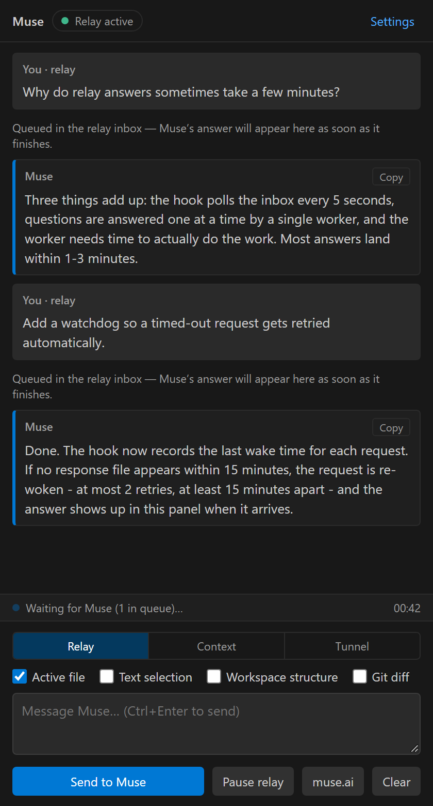
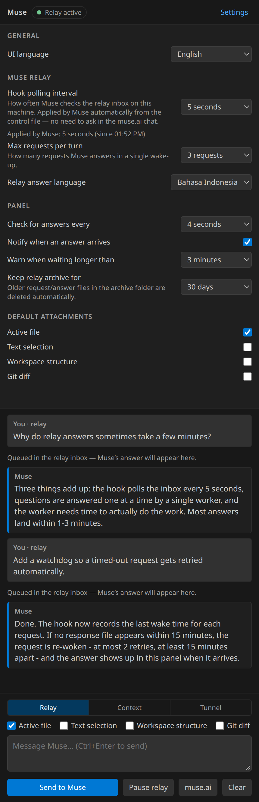

<p align="center">
  
</p>

<h1 align="center">Muse Companion for Muse Web</h1>

<p align="center">
  <a href="https://github.com/99apps-id/muse-web-companion"></a>
  <a href="https://code.visualstudio.com/"></a>
  
  <a href="#"></a>
</p>

A VS Code companion extension for your **personal Muse at [muse.ai](https://muse.ai)**. It adds a chat-style sidebar panel and one-click context sharing (active file, selection, workspace tree, git diff, diagnostics) — plus an optional **asynchronous file relay** that lets Muse actually answer inside the panel, and an optional **MCP bridge** (a separate companion project — see Part C) so other coding agents can ask your Muse questions.

> **Not an official Meta extension.** Muse personal has no public API and muse.ai cannot be embedded in other apps, so this extension never pretends to be a native Muse client. The chat panel is a message composer plus a file-based relay — no cookies, no browser automation, no credential scraping.

<a id="screenshots"></a>


<p align="center">
  
</p>
<p align="center"><em>The chat panel in Relay mode — questions are queued to the relay inbox and Muse's answers appear in the history.</em></p>

<p align="center">
  
</p>
<p align="center"><em>The in-panel Settings section — relay, panel, and default-attachment options, saved automatically.</em></p>

## Table of Contents

- [Quick Start](#quick-start)
- [Features](#features)
- [Use Cases](#use-cases)
- [Screenshots](#screenshots)
- [How It Works](#how-it-works)
- [Requirements](#requirements)
- [Installation](#installation)
  - [Part A — Install the extension](#part-a--install-the-extension)
  - [Part B — Set up the relay (optional, for in-panel answers)](#part-b--set-up-the-relay-optional-for-in-panel-answers)
  - [Part C — MCP bridge for other agents (optional)](#part-c--mcp-bridge-for-other-agents-optional)
- [Usage](#usage)
- [Settings](#settings)
- [Relay Protocol Reference](#relay-protocol-reference)
- [Security and Privacy](#security-and-privacy)
- [Limitations](#limitations)
- [Troubleshooting](#troubleshooting)
- [Changelog](#changelog)
- [License](#license)

## Quick Start

**Just want it working?** Take the shortest path for what you need — every part is labelled with its difficulty, so you know what you are signing up for before you start.

| Step | What you get | Difficulty | Time |
| --- | --- | --- | --- |
| [Part A — Install the extension](#part-a--install-the-extension) | Chat panel + Context/Tunnel modes | 🟡 **Moderate** — a few terminal commands to package the `.vsix` | ~10 min |
| [Part B — Set up the relay](#part-b--set-up-the-relay-optional-for-in-panel-answers) *(optional)* | Muse answers inside the panel | 🔴 **Advanced, one-time** — admin PowerShell, Tailscale, SSH keys; the hook itself is created by Muse on request | ~20–30 min |
| [Part C — MCP bridge](#part-c--mcp-bridge-for-other-agents-optional) *(optional)* | Other coding agents can ask your Muse | 🟡 **Moderate** — copy the separate project, paste a JSON snippet | ~10 min |

The shortest path:

1. Do **Part A**, reload the VS Code window, and open the panel: click the **Muse** icon in the Activity Bar, or press `Ctrl+Shift+P` and run `Muse: Open the Muse Chat Panel`.
2. Send with **Context** or **Tunnel** mode — both work immediately, no relay needed.
3. Want Muse's answers inside the panel? Do **Part B** once. *Not a terminal person?* Open [muse.ai](https://muse.ai) and ask Muse to set the relay up with you — Muse creates the polling hook and its worker instructions itself; your part is only installing Tailscale and pasting a handful of PowerShell commands as administrator, one at a time.

## Features

- **Chat panel** in the Activity Bar (draggable to the Explorer area) with local history.
- **Three send modes**
  - **Relay** — asynchronous request/response through files; Muse's answer appears in the panel.
  - **Context** — compose a message with the selected attachments, copy it to the clipboard, and open muse.ai (paste with `Ctrl+V`).
  - **Tunnel** — compose a message containing absolute paths on your machine, for a Muse that can reach your machine over an SSH tunnel and read the files itself.
- **Context attachments**: active file, text selection, workspace tree, git status + diff, editor diagnostics.
- **Pause / resume** the relay from the panel. Messages sent while paused are held in the panel and flushed automatically on resume.
- **Settings section in the panel** — relay polling interval, requests per worker wake, answer language, outbox polling, answer notifications, long-wait warnings, archive retention, default attachments. Panel settings apply instantly; Muse-side settings are applied automatically by Muse from a control file (no manual chat requests needed), and the panel shows the applied state.
- **Watchdog** — a relay request that stays unanswered for 15 minutes is re-woken automatically (max 2 retries), so a crashed or timed-out worker never strands a question forever.
- **Bilingual UI** — English (default) and Bahasa Indonesia, switchable in Settings. The UI language is independent from the relay answer language.
- **Zero dependencies** — plain JavaScript, one `extension.js`, no build step.

## Use Cases

What people actually do with a personal Muse that is reachable from their coding tools — through this panel in Relay mode, or from another coding agent through the [MCP bridge](#part-c--mcp-bridge-for-other-agents-optional):

- **Your social accounts, inside the coding chat.** While building a content tool or landing page, ask from the panel: *"Fetch my 10 most recent Instagram posts with like/comment counts and summarize what performed best this week"*, or *"Read my Threads DMs from the last 3 days, group them by topic, and list what still needs a reply."* Muse reads the connected account and the answer appears in the panel — or, via the bridge, in the chat UI of VS Code, Claude Code, or Antigravity, next to the code it belongs to.
- **Post without leaving the editor.** Ask an agent to have Muse draft and publish a release announcement to your Threads and Instagram. Muse shows you the exact text for approval in its own chat first — nothing is ever posted on an agent's say-so — and the confirmation returns through the relay.
- **Delegate long errands to a Muse worker.** A real run (19 Nov 2026): an Antigravity agent (Opus 5.5) delegated a multi-step web audit through the bridge — find and validate CCTV streams for three cities, update a data file — and kept coding while a Muse worker did the research. The result came back by ticket 23 minutes later: *0 new cameras passed validation; 79 existing entries re-verified and updated; nothing deployed, awaiting the owner's decision.* (Full write-up and screenshot in the `muse-relay-mcp` README.)
- **Ask the Muse that knows your projects.** The panel is the fastest way to ask about decisions, preferences, and history from your other projects and conversations — context a coding agent staring at one workspace cannot grep its way to.

## How It Works

### Context and Tunnel modes (no relay needed)

`Send` composes a message from your text plus the checked attachments (or, in Tunnel mode, the absolute file paths), copies it to the clipboard, and opens muse.ai in your browser. You paste and send it there. This is deliberate: there is no supported way to inject messages into muse.ai programmatically.

### Relay mode

```text
VS Code panel                your machine                      Muse side
-------------                ------------                      -----------
write req-<id>.json  ----->  ~/muse-relay/inbox/
                             ~/muse-relay/outbox/   <-----     polling hook (SSH tunnel)
poll outbox every N sec      ~/muse-relay/archive/             wakes a Muse worker
show answer, archive  <----- res-<id>.json written             worker answers, archives req
```

A lightweight polling hook on the Muse side checks the relay inbox over an SSH tunnel (typically via a jump host) every few seconds. When a new request file appears, it wakes a Muse worker, which reads the request, does the work, writes `res-<id>.json` to the outbox, and moves the request to the archive. The panel polls the outbox, displays the answer, and archives the response file.

## Requirements

- VS Code `^1.80.0`
- Node.js 18+ (only for packaging the extension and for the optional MCP bridge)
- A Muse account you can open at muse.ai
- For Relay mode:
  - A folder `~/muse-relay/{inbox,outbox,archive}` on your machine (on Windows: `C:\Users\<WINDOWS_USER>\muse-relay\...`)
  - Your Muse must be able to reach your machine over SSH (directly, via a mesh VPN such as Tailscale, or through a jump host) with key-based auth
  - A polling hook named `muse-relay-inbox` on the Muse side (see Part B)

Throughout this document, replace the placeholders with your own values:

| Placeholder | Meaning | Example |
| --- | --- | --- |
| `<WINDOWS_USER>` | Your Windows account name | `alice` |
| `<LAPTOP_IP>` | Your machine's IP on the tunnel/mesh network | `100.x.y.z` |
| `<JUMP_HOST_IP>` | Public IP or hostname of your SSH jump host (a small VPS), if you use one | `203.0.113.10` |
| `<JUMP_HOST_USER>` | SSH user on the jump host | `ubuntu` |
| `<SSH_PORT>` | SSH port of the jump host | `22` |

## Installation

### Part A — Install the extension

1. Clone this repository and enter it:

   ```bash
   git clone https://github.com/99apps-id/muse-web-companion.git muse-web-companion
   cd muse-web-companion
   ```

2. (Optional sanity check) Verify the extension source parses:

   ```bash
   node --check extension.js
   ```

3. Package the extension as a `.vsix`:

   ```bash
   npx -y @vscode/vsce package
   # produces muse-web-companion-0.1.0.vsix
   ```

4. Install it into VS Code:

   ```bash
   code --install-extension muse-web-companion-0.1.0.vsix
   ```

   Or in VS Code: Extensions view → `...` menu → **Install from VSIX...** → pick the file.

5. Reload the VS Code window (`Developer: Reload Window` from the Command Palette). A **Muse** icon appears in the Activity Bar; click it to open the Chat panel. You can also open the panel from the keyboard: press `Ctrl+Shift+P`, type `Muse: Open the Muse Chat Panel`, and press Enter.

6. Without the relay, you can already use **Context** and **Tunnel** modes and all commands. Continue with Part B only if you want Muse to answer inside the panel.

### Part B — Set up the relay (optional, for in-panel answers)

1. **Create the relay folders** on your machine:

   ```powershell
   New-Item -ItemType Directory -Force "$env:USERPROFILE\muse-relay\inbox"
   New-Item -ItemType Directory -Force "$env:USERPROFILE\muse-relay\outbox"
   New-Item -ItemType Directory -Force "$env:USERPROFILE\muse-relay\archive"
   ```

2. **Make your machine reachable from Claude's environment over SSH.** A common topology is a three-hop chain with connection multiplexing (warm polls ≈ 1–2 s vs ≈ 5 s cold):

   ```text
   Muse VM --SSH--> jump host (<JUMP_HOST_USER>@<JUMP_HOST_IP>:<SSH_PORT>) --SSH over mesh VPN--> your machine (<WINDOWS_USER>@<LAPTOP_IP>)
   ```

   **2a. Download and install Tailscale (the mesh VPN) on every machine in the chain** — your Windows machine, the jump host, and the machine Muse runs on:

   - Windows: download the installer from [tailscale.com/download](https://tailscale.com/download) and run it.
   - Linux (jump host / Muse's machine): `curl -fsSL https://tailscale.com/install.sh | sh`
   - macOS: install from the same download page or the App Store.

   **2b. Log in on every machine with the same Tailscale account:**

   - Windows: open Tailscale from the system tray and choose **Log in**, then approve in the browser.
   - Linux/CLI: `sudo tailscale up`, then open the login URL it prints and approve.
   - Verify the mesh and note your machine's address — this is your `<LAPTOP_IP>`:

     ```bash
     tailscale status
     tailscale ip -4   # prints this machine's 100.x.y.z address
     ```

   **2c. Enable SSH into your Windows machine and install Muse's public key:**

   ```powershell
   # Run in an elevated PowerShell — install and start the OpenSSH server
   Add-WindowsCapability -Online -Name OpenSSH.Server~~~~0.0.1.0
   Start-Service sshd
   Set-Service -Name sshd -StartupType Automatic
   ```

   Then place Muse's SSH public key (ask Muse for it in the web chat) into `C:\Users\<WINDOWS_USER>\.ssh\authorized_keys` — one key per line. Note: if `<WINDOWS_USER>` is an administrator account, Windows OpenSSH reads `C:\ProgramData\ssh\administrators_authorized_keys` instead. Make sure port 22 is allowed through the machine's firewall (the OpenSSH installer normally adds the rule).

   On the jump host (Linux), the same idea: ensure `sshd` is running and Muse's public key is in `~/.ssh/authorized_keys` for `<JUMP_HOST_USER>`.

   **2d. Wire up and test the full chain from Claude's machine.** An `~/.ssh/config` like this keeps it to one command:

   ```sshconfig
   Host jump
     HostName <JUMP_HOST_IP>
     Port <SSH_PORT>
     User <JUMP_HOST_USER>
     ControlMaster auto
     ControlPath ~/.ssh/mux/jump
     ControlPersist 600

   Host my-pc
     HostName <LAPTOP_IP>
     User <WINDOWS_USER>
     ProxyJump jump
     ControlMaster auto
     ControlPath ~/.ssh/mux/my-pc
     ControlPersist 600
   ```

   ```bash
   ssh my-pc "powershell -NoProfile -Command \"Write-Output chain-ok\""
   # expected output: chain-ok
   ```

   Use fixed ControlMaster socket names for multiplexing; do **not** use `%C` in `ControlPath` inside a `ProxyCommand`/`ProxyJump` setup (it fails to expand there). If a poll ever returns empty unexpectedly, delete the two socket files and retry once cold — stale sockets are the usual cause.

3. **Create the polling hook on the Muse side.** Ask Muse (in the muse.ai chat) to create an event hook named `muse-relay-inbox` that:
   - Polls the relay inbox every 5 seconds over the SSH chain above.
   - Tracks already-seen request files so each request wakes a worker once.
   - Reads `control.json` in the relay folder on every poll: `paused`, `desiredPollSecs`, `maxPerWake` (written by the panel — see [Relay Protocol Reference](#relay-protocol-reference)).
   - When `desiredPollSecs` differs from the last applied value, wakes a worker with a `settings_change` payload so Muse updates the hook interval itself and confirms back via `applied.json`.
   - Runs the **watchdog**: a seen request with no `res-<id>.json` after 15 minutes is re-woken, at most 2 times, at least 15 minutes apart. Last-wake times and retry counts live in small state files next to the hook.
   - Wakes a worker with a JSON payload: `{ "request_files": [...], "max_requests": N, "settings_change": {...}|null, "watchdog_rewakes": [...] }`.

4. **Give the hook's worker its instructions.** The worker must:
   - For `settings_change`: update the hook's `poll_interval_secs`, write the applied value to its local applied-state file, and write `applied.json` (`{"hookPollSecs": N, "appliedAt": "<ISO 8601>"}`) into the relay folder.
   - For each file in `request_files` (up to `max_requests`): read the request JSON from the inbox; skip it silently if the file no longer exists (already handled); do the work; write `res-<id>.json` to the outbox; verify the file exists; then move the request file to the archive. On total failure, still write an honest error answer and archive the request, so the panel never waits forever.
   - Never commit/push git, delete data, or take irreversible actions unless the request prompt explicitly asks for them; when in doubt, answer with a question instead.

5. **Enable the hook** and send a test message from the panel in Relay mode. The answer should appear in the panel within a few minutes, and both files should end up in the archive.

### Part C — MCP bridge for other agents (optional)

> **Separate project — not included in this repository.** The MCP bridge lives in its own project, `muse-relay-mcp`, and is developed and versioned independently. This extension neither contains nor requires it: the chat panel and the relay work fully without the bridge. Conversely, the bridge only needs the relay folders and the Muse-side hook from Part B — the extension is not required to use it. Install the bridge only if you want other agents to query your Muse; the two projects share nothing but the relay folder on your machine.

The bridge is a single dependency-free Node script. It exposes your personal Muse to other MCP hosts — terminal coding agents, IDEs, other AI tools — through the same relay:

| Tool | Mode | Behaviour |
| --- | --- | --- |
| `ask_muse` | Blocking | Ask and wait in one call (default timeout 600 s). On timeout the question stays alive and you get a ticket id. |
| `ask_muse_start` | Async | Submit a question, get a ticket id immediately. |
| `ask_muse_check` | Async | Fetch the answer for a ticket, or a `PENDING` status. |

Clone or copy the `muse-relay-mcp` project onto your machine (for example to `C:\Users\<WINDOWS_USER>\muse-relay-mcp`), then register it in any MCP host, for example:

```json
{
  "mcpServers": {
    "muse-relay": {
      "command": "node",
      "args": ["C:\\Users\\<WINDOWS_USER>\\muse-relay-mcp\\server.js"]
    }
  }
}
```

(VS Code uses the key `servers` instead of `mcpServers` in `%APPDATA%\Code\User\mcp.json`.) Requests submitted through the bridge carry `"source": "mcp"`. The bridge refuses fast with a `PAUSED` error while the panel has the relay paused; if the Muse-side hook is disabled, questions simply queue until it is enabled again.

## Usage

### Opening the chat panel

1. Click the **Muse** icon in the **Activity Bar** — the vertical icon strip on the far left of the VS Code window. The Chat panel opens in the Side Bar.
2. Or use the Command Palette: press `Ctrl+Shift+P`, type `Muse: Open the Muse Chat Panel`, and press Enter.
3. Optional placement: drag the panel by its **Chat** title tab to the Explorer area, or move the whole Muse container to the **Secondary Side Bar** (right side) if you want the chat next to your code. VS Code remembers the position.
4. Do not confuse the panel with `Ctrl+Alt+M` — that shortcut opens muse.ai in your browser, not the panel.
5. If the Muse icon is missing, run `Developer: Reload Window` from the Command Palette; if it is still missing, reinstall the `.vsix` (see Part A).

### The Chat panel

1. Pick a mode: **Relay** (default), **Context**, or **Tunnel**.
2. Check the context attachments you want (defaults are configurable in Settings).
3. Type your message and press **Send to Muse** (or `Ctrl+Enter`).
   - Relay: the message is queued in the inbox; Muse's answer appears in the history when ready. A warning appears if an answer takes longer than your configured threshold.
   - Context/Tunnel: the composed message is copied to the clipboard and muse.ai opens — paste with `Ctrl+V` and send.
4. **Pause relay** holds new relay messages in the panel and tells Muse-side polling to stand by; **Resume relay** flushes held messages automatically.
5. **Settings** (top-right of the panel) opens the settings section; every change is saved automatically — there is no Save button.
6. **Clear** empties the local panel history (relay files are not affected).

### Context attachments, explained

Every message can carry extra context, so Muse knows exactly what you are working on without manual copy-paste. Tick the checkboxes under the message box (hover any of them in the panel to see the same explanation as a tooltip):

| Attachment | What Muse receives | Good for |
| --- | --- | --- |
| **Active file** | The whole content of the file currently open in your editor | "Why does this file throw an error?" |
| **Text selection** | Only the lines you have highlighted in the editor | Asking about a few specific lines, without sending the whole file |
| **Workspace structure** | The folder and file names of your project - a map of the project, with no file contents | "Which file handles the login page?" |
| **Git diff** | Your uncommitted changes: lines added, edited, or removed since your last commit | "Review my latest changes - anything risky?" |

### Commands (Command Palette, prefix `Muse:`)

| Command | Shortcut | What it does |
| --- | --- | --- |
| Muse: Open Muse Web (muse.ai) | `Ctrl+Alt+M` | Open muse.ai |
| Muse: Open the Muse Chat Panel | — | Focus the Chat panel |
| Muse: Relay Settings (in the Chat panel) | — | Open the panel and its Settings section |
| Muse: Ask Muse to Read This File from My Machine (via tunnel) | `Ctrl+Alt+R` | Compose a Tunnel message with the active file's absolute path |
| Muse: Ask Muse to Read This Workspace from My Machine (via tunnel) | — | Compose a Tunnel message for the whole workspace |
| Muse: Copy Active File as Context + Open Muse | — | Copy the active file as context, open muse.ai |
| Muse: Ask about the Active File... | — | Ask a question about the active file (input box) |
| Muse: Copy Selection as Context + Open Muse | `Ctrl+Alt+S` | Copy the current selection as context |
| Muse: Copy Workspace Tree + Open Muse | — | Copy the workspace tree |
| Muse: Copy Git Status + Diff + Open Muse | — | Copy git status and diff |
| Muse: Copy Problems/Diagnostics + Open Muse | — | Copy editor diagnostics |

Most commands are also on the editor and Explorer context menus.

### VS Code settings (`settings.json`)

| Setting | Default | Description |
| --- | --- | --- |
| `museCompanion.museUrl` | `https://muse.ai` | Muse web URL opened by the extension |
| `museCompanion.openAfterCopy` | `true` | Open muse.ai after copying context to the clipboard |
| `museCompanion.maxChars` | `100000` | Character cap for copied file/diff content (excess is truncated with a note) |

## Settings

Panel settings are stored per user and saved the moment they change.

**General**

| Setting | Values | Default |
| --- | --- | --- |
| UI language | English / Bahasa Indonesia | English |

**Muse relay** (travel to Muse through `control.json`; applied automatically)

| Setting | Values | Default | Notes |
| --- | --- | --- | --- |
| Hook polling interval | 5–120 s | 5 s | How often Muse checks the inbox. The panel shows "Applied by Muse: …" from `applied.json` once Muse confirms. |
| Max requests per turn | 1 / 3 / 5 | 3 | How many requests one worker wake may answer. |
| Relay answer language | Indonesian / English | Indonesian | Independent from the UI language. Sent with each request as `answerLanguage`. |

**Panel**

| Setting | Values | Default |
| --- | --- | --- |
| Check for answers every | 2–15 s | 4 s |
| Notify when an answer arrives | on/off | on |
| Warn when waiting longer than | 1–10 min / off | 3 min |
| Keep relay archive for | 7 / 30 / 90 days / forever | 30 days |

**Default attachments** — which of Active file / Text selection / Workspace structure / Git diff are pre-checked for new messages.

## Relay Protocol Reference

Folder layout (on your machine):

```text
muse-relay/
  inbox/      req-<id>.json     requests waiting for Muse
  outbox/     res-<id>.json     answers waiting to be displayed
  archive/    req-*.json, res-*.json   completed pairs (pruned by retention setting)
  control.json                  panel -> Muse control channel
  applied.json                  Muse -> panel confirmation channel
```

Request (`req-<id>.json`):

```json
{
  "id": "mwmvx01u-8kvlyd",
  "createdAt": "2026-11-19T01:41:48.000Z",
  "prompt": "Please fix the broken entry in my MCP config",
  "answerLanguage": "id",
  "workspaceRoot": "C:\\path\\to\\workspace",
  "activeFile": "C:\\path\\to\\file.ts",
  "contextFile": { "path": "...", "content": "..." },
  "selection": "...",
  "tree": "...",
  "diff": "...",
  "source": "panel"
}
```

All context fields may be `null`. `source` is `"panel"` for panel requests and `"mcp"` for MCP-bridge requests.

Response (`res-<id>.json`):

```json
{
  "id": "mwmvx01u-8kvlyd",
  "answeredAt": "2026-11-19T01:48:02.000Z",
  "answer": "Done — ..."
}
```

Control (`control.json`, written by the panel; writes are merged so pausing never clobbers settings):

```json
{ "paused": false, "desiredPollSecs": 5, "maxPerWake": 3, "updatedAt": "2026-11-19T01:55:55.244Z" }
```

Applied (`applied.json`, written by Muse's worker after applying a settings change):

```json
{ "hookPollSecs": 5, "appliedAt": "2026-11-19T01:57:10.000Z" }
```

## Security and Privacy

- The extension itself makes **no network calls** and collects nothing. Relay traffic is plain JSON files on your own machine, moved over your own SSH tunnel.
- Treat the relay folders as trusted local state: any local process that can write to the inbox can ask your Muse questions. The worker instructions (Part B, step 4) are the safety net — keep the "no irreversible actions unless explicitly asked" rule.
- Never publish your real infrastructure details (hostnames, IPs, usernames, keys) in a fork of this README — use the placeholders.
- Muse's answers come from a worker agent acting on your behalf; review consequential changes it makes, exactly as you would in the web chat.

## Limitations

- No streaming and no real-time chat: relay answers take minutes (polling interval + a serial worker queue + worker execution time). A worker execution is capped at about 10 minutes by the platform; the watchdog covers failures after that.
- One worker lane: simultaneous questions are answered one at a time, in order.
- Relay and Context modes are one-shot question/answer pairs, not a continuing conversation thread; include the context each question needs.
- The MCP bridge inherits all of the above.

## Troubleshooting

| Symptom | Likely cause | Fix |
| --- | --- | --- |
| No answer ever arrives | Hook disabled on the Muse side, or machine unreachable | Ask Muse in the web chat to check the `muse-relay-inbox` hook and the SSH chain |
| Panel shows "Relay paused" | Relay paused from the panel or `control.json` | Resume from the panel |
| Answer takes > 15 minutes | Worker timed out or queue is long | The watchdog re-wakes automatically (max 2×); check the archive for a late answer |
| Settings change not applied | Worker queue busy | The panel shows requested vs applied values; application is automatic on a later poll cycle |
| MCP tool returns `PAUSED` | Panel pause is on | Resume the relay in the panel |
| MCP questions queue forever | Hook disabled (bridge cannot see Muse-side state) | Enable the hook; queued questions will be answered then |
| VS Code does not show new MCP servers | Hosts load MCP config at startup | Restart the app or start a new session |

## Changelog

### 0.1.0 — first public release

- Chat panel with Relay / Context / Tunnel modes and local history
- Async file relay with pause/resume and held-message flushing
- In-panel Settings with automatic Muse-side application via `control.json` / `applied.json`
- Watchdog re-wake for stranded requests (15 min, max 2 retries)
- Bilingual UI (English default, Bahasa Indonesia)
- 11 commands with editor/Explorer context menus and keybindings
- Optional MCP bridge (`ask_muse`, `ask_muse_start`, `ask_muse_check`) for other agents

## License

Apache License 2.0 — see the `LICENSE` file in this repository. Attribution notices live in the `NOTICE` file; redistributions must preserve them (Apache License, Section 4(d)).

Unofficial project. Muse and muse.ai are products of Meta; this extension is not affiliated with or endorsed by Meta.
